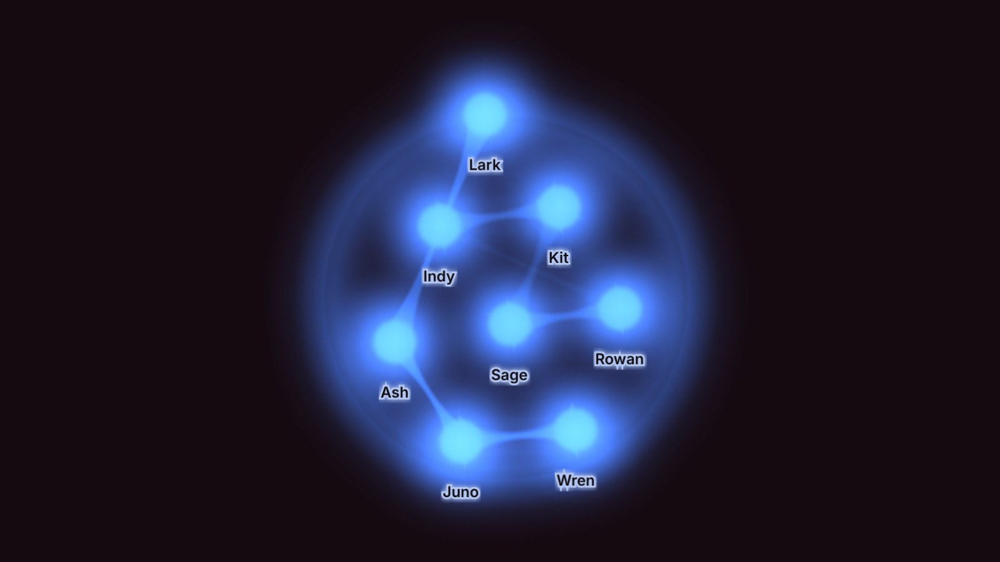
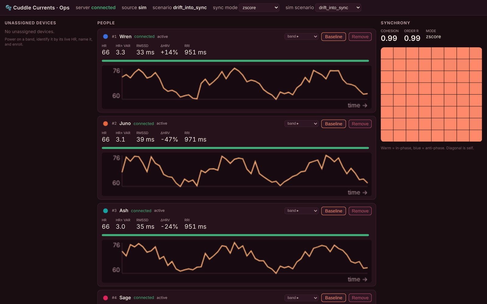

<div align="center">

# Cuddle Currents

### **Watch a room full of hearts fall into step.**


*A live visualizer for interpersonal heart-rate synchrony: everyone in a cuddle puddle wears a heart-rate band, and the screen shows whose hearts are moving together, in real time.*

[**Demo**](#see-it-in-action) · [**Quick Start**](#quick-start) · [**How It Works**](#how-it-works) · [**Hardware**](#hardware)

</div>

---

## The Problem Everyone Ignores

You can feel it when a group settles into each other: a cuddle puddle goes quiet, breathing slows, attention turns inward. Research says that feeling is physiological: people's heart rhythms start to co-move, and how much they do tracks real social engagement and group cohesion.

But in the room, nobody can see it.

- **Heart-rate apps show one person at a time.** Synchrony is about pairs and groups, not individuals.
- **The obvious comparison is wrong.** Two people with the same elevated heart rate can be completely out of sync; two with very different resting rates can be locked together.
- **Noise looks like connection.** A calm, flat heart signal correlates with anything, so a naive display would show quiet people as "in sync" with everyone.
- **Bluetooth runs out of room.** A laptop holds about 7–10 bands at once. A real puddle is bigger than that.

## The Insight That Changed Everything

Synchrony isn't about having the *same* heart rate. It's about heart rates that *rise and fall together*.

<div align="center">

### **Compare the dynamics, not the levels,**
### **and let distance on the screen mean correlation over time.**

</div>

Baseline every person at rest, normalize them, and measure how their fluctuations co-move with metrics that ignore offsets entirely. Then draw people as glowing dots in a force-directed layout where sustained agreement pulls them together: hearts that move together clump, sub-groups form their own clusters, and anti-correlated pairs are pushed to opposite ends.

<div align="center">

## **The closer the glow, the closer the hearts.**

</div>

## Introducing Cuddle Currents

| Component | Role |
|:----------|:-----|
| **Bands** | Any standard BLE heart-rate strap (tested: Coospo HW706 and HW9), reporting beat-to-beat (RR) intervals |
| **Sources** | Bands direct to a Mac over BLE, ESP32-S3 gateways forwarding over MQTT, a built-in simulator, or a recorded session replay, all behind one swap point |
| **Processing** | Beat-level artifact correction, per-person rest baseline, windowed concordance, the Kuramoto order parameter and group cohesion |
| **Show view** (`/`) | The full-screen "puddle", made for a big screen in the room |
| **Ops view** (`/ops`) | Enrollment, signal quality, raw traces and the synchrony heatmap, for whoever runs the session |

## See It In Action

<div align="center">



*The Show view: eight simulated hearts after `drift_into_sync`, pulled into one puddle.*



*The Ops view at the same moment: every trace co-moves, the heatmap is warm across the board, and cohesion and the order parameter both read 0.99.*

</div>

## What Makes It Different

| Feature | What It Does | Why It Matters |
|:--------|:-------------|:---------------|
| **Offset-invariant synchrony** | Windowed concordance (Pearson under `zscore`) and the Kuramoto order parameter R | Reads shared *dynamics*, not shared heart rate, which is what the research says synchrony is |
| **Per-person baseline** | Each person is calibrated at rest before joining the puddle | Different resting rates and HRV don't masquerade as (dis)connection |
| **Honest visuals** | A flat-signal gate and temporal smoothing (EMA) on the Show view | Calm, uninformative signals aren't drawn as confidently synced, and a one-frame spike can't form a cluster |
| **Beat-level artifact correction** | Hampel filter, Malik floor and missed/extra-beat repair | Removes sensor spikes without flattening the real dynamics |
| **Built to scale** | ESP32-S3 BLE→WiFi gateways, 6 bands each (hardware-validated), with OTA fleet updates | Past the laptop's 7–10 band limit, toward ~30 people (≈5 gateways) |
| **Band reuse** | Hand a band from one person to another; parked people keep their baseline | A handful of bands can rotate through a whole room |
| **A glyph for everyone** | 8 colors × 8 shapes plus a seat number | "You're #7, the teal triangle": anyone can find their own dot |
| **No hardware needed to try it** | Eight simulator scenarios, plus record and replay | Demo it anywhere, and replay real sessions without the bands |

## Quick Start

```bash
pip install -e .
cuddle --source sim --scenario drift_into_sync --people 6
```

Open the **Show** view at http://127.0.0.1:8770/ and the **Ops** view at http://127.0.0.1:8770/ops, ideally on two screens. On Ops, enroll each simulated band, press **Baseline**, and watch them join the puddle and drift into sync. See [Running it](#running-it) for real bands, gateways and replay.

## How It Works

### The science, briefly

Heart-rate synchrony is a measurable marker of real-world social engagement: in the wild
it rises with **physical proximity** (dyads within ~20 m), is stronger between **socially
familiar** people, and collapses in loud environments (He et al., *Heart rate synchrony
as a marker of real-world social engagement*, PNAS Nexus 2026,
[10.1093/pnasnexus/pgag181](https://doi.org/10.1093/pnasnexus/pgag181)). At the group
level, continuous inter-beat coupling **predicts group cohesion** (Tomashin, Gordon &
Wallot, *Interpersonal Physiological Synchrony Predicts Group Cohesion*, Front. Hum.
Neurosci. 2022, [10.3389/fnhum.2022.903407](https://doi.org/10.3389/fnhum.2022.903407)).

**The mechanism.** The interval between heartbeats is continuously regulated by the
autonomic nervous system, so each person's heart rate is a *fluctuating envelope*, not a
fixed number. Two people's envelopes come into alignment through two pathways: a
**stimulus-driven** one — both nervous systems modulated at once by a shared event,
amplified by co-presence and joint attention — and an **interaction-driven** one —
reciprocal co-regulation via the exchange of social signals (speech prosody, facial
expression, gesture). Crucially, synchrony is an alignment of *dynamics*, not of arousal
*level*: two people can share an elevated heart rate and be completely unsynchronized
(the PNAS Nexus study found no link between mean HR and synchrony). What matters is
whether their fluctuations **co-move** — which is why proximity, familiarity, and a quiet
setting matter (they enable the shared input and social exchange), and why the metrics
below are deliberately offset-invariant.

We quantify it two ways:

- **Concordance (matrix):** windowed Lin's concordance of smoothed HR between each
  pair. Under the default `zscore` normalization this equals windowed Pearson
  correlation (pure dynamics, offset-invariant).
- **Phase-locking / Kuramoto order parameter (R):** the length of the average of
  everyone's beat-phase unit vectors — offset-robust, and the single "how synced is
  the puddle" scalar (0–1). Note R is *not* 0 at no-sync: for N independent people it
  sits around 1/√N (~0.45 for 5), so judge synchrony by R rising above that baseline.
  It's complementary to cohesion — R measures beat *timing*, cohesion the HR *dynamics*.

Because individual physiology differs (resting HR, HRV, respiration), each person is
**baselined** at rest and their signal normalized before comparison.

One caveat the visualization respects: `zscore` concordance reads *dynamics*, so when a
person's HR is essentially **flat** (windowed SD near the sensor noise floor — ~1 bpm at
calm rest) it correlates noise and is unreliable. The Show puddle therefore **gates
concordance on HR variability** — a correlation only counts when both hearts actually
vary — so calm, uninformative signals are not drawn as confidently synced. For flat
traces, level agreement (`raw` mode, or simply the per-person HR readouts) is what to
trust.


### The pipeline

```
sources/  →  hub/  →  processing/  →  transport/  →  frontend/
(BLE|sim|    (registry (resample,      (FastAPI      (show + ops
 replay|      enrollment  quality,       /ws + REST)   pages)
 mqtt gw      ingest)     baseline,
 behind a                 abstract,
 Protocol)                synchrony)
```

The `SampleSource` Protocol (`src/cuddle/sources/base.py`) is the one swap point:
direct BLE, the simulator/replay, and the BLE→WiFi gateway (MQTT) source all feed the same
normalized per-person sample stream — nothing downstream knows the origin. Bands are expected
to roam in and out of range — each device
auto-reconnects with backoff, and sessions are keyed by a stable `person_id` so a
drop-and-rejoin preserves history and matrix position.


## The Story Behind Cuddle Currents

The question behind it is simple: when a group of people lie together in a cuddle puddle and the room goes calm, is something actually syncing up? The research says yes. Heart-rate synchrony rises with physical proximity and familiarity, and at the group level it predicts cohesion. The project set out to make that visible, live, in the room where it happens.

Phase 1 was a proof of concept: a handful of standard heart-rate bands talking straight to a Mac over Bluetooth, a simulator to develop against, and two screens, one beautiful and one honest. Getting the honest part right meant learning where synchrony is easy to fake: comparing heart-rate levels instead of dynamics, reading noise from a calm heart as connection, letting one spike pull two people together.

Then the room got bigger than Bluetooth allows. The answer was ESP32-S3 gateways that relay raw heart-rate packets over Wi-Fi, six bands each, updated over the air as a fleet, and an orchestrator that decides which gateway holds which band (validated against a mock multi-gateway harness; on-hardware validation is still pending). The target is a puddle of about thirty people, all on one screen.

<div align="center">

### Connection you can feel, made visible.

</div>

---

# Reference

## Hardware

**Bands.** Coospo **HW706** (BT 4.0) and **HW9** (BT 5.0) both expose the standard BLE Heart
Rate Service (`0x180D` / `0x2A37`) including RR intervals — no proprietary protocol. Any
standard BLE HR strap should work.

**Gateways (ESP32-S3).** macOS CoreBluetooth holds only ~7–10 peripherals at once, so scaling
past a handful of people uses **BLE→WiFi gateways**: an ESP32-S3 connects to the bands and
forwards the raw `0x2A37` notifications to the app over MQTT — the app still does all decoding,
so a gateway stays a dumb bridge. Firmware lives in `firmware/`:

- [`firmware/gateway-idf/`](firmware/gateway-idf/README.md) — the **ESP-IDF** build,
  **6 concurrent bands** (hardware-validated), plus Level B "managed mode". The recommended build.
- [`firmware/gateway/`](firmware/gateway/README.md) — the simpler **arduino-cli** build, capped
  at **3** concurrent bands by the precompiled BT controller. Fallback / no-IDF-toolchain path.

Both provision Wi-Fi + broker at runtime via a captive portal (no Wi-Fi credentials in the
repo). Rough sizing: ~`ceil(people / 6)` IDF gateways (≈5 for 30 people). See each firmware
README for the toolchain, build, flash, and provisioning steps.

**Over-the-air updates.** After the initial USB flash, the whole IDF-gateway fleet updates
over Wi-Fi — bump `version.txt`, `idf.py build`, then push via the Ops "Update fleet" button
(or `POST /api/ota`); each gateway pulls, flashes, and auto-rolls-back if the new image can't
get healthy. Full steps in the [gateway OTA section](firmware/gateway-idf/README.md#ota-updates).

## Running it

```bash
pip install -e .              # or: pip install -e '.[dev]' for tests

# Run against the built-in simulator (no hardware needed) — the demo path:
cuddle --source sim --scenario drift_into_sync --people 6

# Then open, in two separate windows:
#   Show view (clean puddle):   http://127.0.0.1:8770/
#   Ops view  (technical):      http://127.0.0.1:8770/ops
```

The simulator is just the demo path. `--source` selects where samples come from:

```bash
cuddle --source ble                                   # real bands direct to the Mac (≤ ~7)
cuddle --source mqtt --broker 192.168.1.50:1883       # bands via an ESP32 gateway, over MQTT
cuddle --source mqtt --broker 192.168.1.50:1883 --orchestrate   # + Level B multi-gateway
cuddle --source replay --capture captures/session.jsonl         # replay a recording, no hardware
```

`ble` needs bands in range of the Mac; `mqtt` needs a running broker (mosquitto) and at least
one flashed gateway (see [`firmware/`](firmware/)); `--orchestrate` adds app-authoritative
placement across gateways (Level B — see the roadmap). Any real-band run can add
`--record captures/x.jsonl` to log raw samples for later hardware-free replay.

The server binds `127.0.0.1:8770` by default (an uncommon port, to avoid colliding
with other local services). Override the port and host per-run with
`cuddle --port 9001 --host 0.0.0.0`, or persistently in `config/app.yaml`
(`transport.port` / `transport.host`). The frontends discover the port automatically,
so no other change is needed.

On the **Ops** page: enroll each device (identify it by its live HR), press
**Baseline**, and once calibrated the person goes active and joins the puddle on the
**Show** page. Flip the **sync mode** and **scenario** selectors to see the effect.
(For quick demos the simulator shortens the baseline via `--baseline-scale`.)

Each person gets a unique visual identity — a **color × shape** glyph (8 colors ×
8 shapes = 64 combos, covering the 30-person target) plus a **seat number** — so
anyone can find their own dot ("you're #7, the teal triangle"). The glyph and seat
show on every Ops card; on the Show view, press **L** to reveal initials or numbers.

**Reusing bands across people** (for when you have fewer bands than people): on an
Ops person card, the **band ▸** menu hands that person's band to someone else or
**releases** it. A released person is *parked* — kept in the roster with their name,
identity, and baseline, just without a band — and their freed band returns to the
**Unassigned devices** list, where an **assign to parked…** menu can hand it to any
parked person. Reassigning to someone who's already baselined reactivates them
instantly (no re-baseline). So a handful of bands can rotate through many people
while every person's baseline is retained. To drop someone from the roster entirely,
the **Remove** button on their card (two-click confirm) retires them and returns their
band to the pool.

### Simulator scenarios (`--scenario`, sim only, switchable live in Ops)

| Scenario | What it shows |
|---|---|
| `independent` | Uncoupled hearts — synchrony stays near zero (baseline/control). |
| `drift_into_sync` | Coupling ramps up; the group gradually locks into one pulsing puddle. |
| `dropout` | A band roams out and rejoins — exercises the connection lifecycle. |
| `cliques` | Two sub-groups lock internally at different rates — the puddle forms separate clumps. |
| `anti_phase` | Two groups whose HR envelopes run in anti-phase — cross-group concordance goes strongly negative, so the two clumps are flung to opposite ends (the max-distance case). |
| `sync_then_break` | The group locks together, holds, then coupling releases and they drift apart. |
| `contagion` | Sync spreads from a seed outward — members join the locked group one at a time. |
| `pacer` | An external rhythm (guided co-breathing) everyone couples toward, pulling mixed rates to a common ~63 bpm. |

With real bands:

```bash
cuddle --source ble --record captures/session.jsonl
```

Recorded sessions replay without hardware:

```bash
cuddle --source replay --capture captures/session.jsonl
```

## Two independent frontends

The backend serves one WebSocket stream (`/ws`) to two decoupled pages, meant to run
in parallel on different monitors:

- **`/` Show** — the final visualization: a clean, full-screen "puddle." Each person is
  a glyph in a gentle **force-directed layout where distance encodes correlation over
  time**: strongly concordant hearts **clump** (and sub-groups that sync separately
  settle into **separate clusters**, each with its own soft glow), uncorrelated people
  sit **far apart**, and anti-correlated pairs are pushed **farthest of all**. Two
  guards keep it honest — an **EMA** so only *sustained* concordance gathers a cluster
  (not a one-frame spike), and the **flat-signal gate** above (a correlation counts only
  when both hearts actually vary). Motion is heavily damped and speed-capped, so dots
  ease into place rather than darting, and the constellation is sized to use the screen.
  The beat is an in-place pulse. When someone becomes active (enrolled or handed a band)
  a brief cue announces their glyph + seat ("Wren · #1 — sapphire circle"). Press **L**
  to cycle on-dot labels (none → initials → seat number).
- **`/ops` Ops** — the technical status: per-band connection lifecycle, raw HR/RR trace
  + signal quality, the abstract per-person signal, and the synchrony heatmap. Cards
  sort **active sessions above disconnected ones**, and a person who (re)connects jumps
  to the top; each card has a **Remove** control (see band reuse above).

## Development

```bash
pytest            # BLE parser, synchrony, baseline, reconnect, enrollment, sim scenarios,
                  # artifact correction, MQTT gateway source, and Level B orchestration
```

Key modules:

- `sources/ble_parser.py` — pure `0x2A37` decoder (golden-tested).
- `sources/sim_source.py` — Kuramoto-coupled cardiac-oscillator simulator + replay,
  with a shared-arousal envelope so coupled HR *levels* co-move (and, in `anti_phase`,
  counter-move) — the signal cross-person concordance actually reads.
- `hub/enrollment.py` — enroll → baseline → active, plus band reuse (assign / park /
  reassign / remove); binding stays consistent across the registry and the source so a
  reassigned or removed band never keeps routing to its old owner.
- `processing/baseline.py` — the rest-capture calibration that gates a person to active.
- `processing/artifact.py` — beat-level spike correction (Hampel + Malik floor +
  missed/extra-beat repair) feeding HRV/synchrony; surgical so it doesn't flatten the
  real dynamics the coherence metric reads. Config under `artifact:` in `app.yaml`.
- `processing/synchrony.py` — concordance + PLV + group cohesion.
- `frontend/js/show/puddle.js` — the force-directed puddle: concordance→distance
  mapping, flat-signal gate, and temporal smoothing (tunables at the top of `FORCE`).

## Roadmap (Phase 2)

BLE→WiFi gateway / MQTT ingestion, ~30-person scale, and session persistence beyond
JSONL captures.

**Level B orchestration** (app-orchestrated gateway assignment) has landed on the Phase-2
branch: `cuddle --source mqtt --orchestrate` gives the app full authority over which gateway
holds which band (stability-first — connected bands aren't moved except a bounded
unserved-band rebalance — with auto-revert to opportunistic per-gateway assignment if the
orchestrator dies). Validated end-to-end against a mock multi-gateway harness; on-hardware
validation of the firmware's managed mode is still pending. See
[`docs/superpowers/roadmap.md`](docs/superpowers/roadmap.md) for details.

## License

MIT — see [LICENSE](LICENSE).


---

<div align="center">

**See the room breathe together.**

If it made your puddle glow, [star the repo](https://github.com/bash102/cuddle-currents).

</div>
